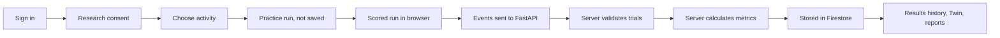

# Attune ADHD Research Platform: Project Report

Status as of 14 November 2026. This report explains, in simple technical terms, what has been built, which technologies it uses, how it works end to end, and what is still missing. It is written for studying and for onboarding a new team member.

> **Research prototype.** Nothing here is a clinical diagnostic tool. Cognitive activities are demonstration tasks, and the EEG model is not yet working or connected to the website.

---

## 1. What this project is

The project has two connected parts:

1. **Attune, a web platform.** A participant signs in, gives research consent, and plays short cognitive tasks (attention, memory, planning and so on). The server checks every trial, calculates the scores, stores them securely, and shows results and history. There are also views for caregivers, clinicians and researchers, a "Digital Twin" summary, PDF reports, and data-rights tools (export and erase).
2. **An EEG research model (RG-AGTL).** A machine-learning pipeline that tries to classify ADHD from resting-state EEG using the public TDBRAIN dataset. The idea is described in section 11. This part runs separately in a notebook and is **not** yet connected to the website.

---

## 2. Big picture

```text
                        BROWSER (Next.js / React)
        pages, 11 cognitive activities, charts, forms, demo mode
                               |
              Firebase Authentication (sign-in, ID token)
                               |   Authorization: Bearer <token>
                               v
                       FastAPI backend (Python)
        verifies token, checks role + ownership + consent,
        validates trials, calculates metrics, builds reports
                               |   Firebase Admin SDK
                               v
                        Cloud Firestore (database)

   Separate, not connected yet:
   TDBRAIN EEG  ->  RG-AGTL model (notebook)  ->  results, SHAP, occlusion
```

Key idea: **the browser is not trusted.** The browser shows the task and records responses, but the server holds the real trial lists and answer keys, rejects mismatching data, and calculates every score itself.



---

## 3. Technology stack

| Layer | Technology | Version | Why it is used |
|---|---|---|---|
| Frontend framework | Next.js (App Router) | 16.4.3 | Pages, routing, server and client components |
| UI library | React | 19.3.0 | Component-based interface |
| Language | TypeScript | 5.x | Type safety across the frontend |
| Styling | Tailwind CSS | 4 | Utility-first styling |
| Charts | Recharts | 3.x | Progress and Twin charts |
| Icons | lucide-react | 1.x | Icons |
| Auth (client) | Firebase Web SDK | 11.x | Sign-in, ID tokens, direct Firestore for legacy features |
| Backend framework | FastAPI | 0.162 | REST API with automatic validation |
| Server | Uvicorn | 0.54 | Runs the FastAPI app |
| Data models | Pydantic | 2.14 | Request/response validation (camelCase JSON, extra fields forbidden) |
| Backend database access | Firebase Admin SDK | 7.7 | Verifies tokens, reads and writes Firestore |
| Database | Cloud Firestore | n/a | Document database for all application data |
| Identity | Firebase Authentication | n/a | Accounts, trusted role claims |
| Maths | NumPy, pandas | 2.5 / 3.1 | Metric calculations |
| Backend language | Python | 3.13 | Backend and test tooling |
| Backend tests | pytest, httpx, ruff | 9.2 / 2.16 / 0.17 | Unit/API tests and linting |
| Frontend tests | Vitest | 5.x | Unit tests |
| Browser tests | Playwright | 1.65 | End-to-end tests (live signed-in flow) |
| Firestore rules tests | @firebase/rules-unit-testing | 4.x | Security rules checks on the emulator |
| Emulators | firebase-tools | 15.34.2 | Local Auth and Firestore for tests |
| CI | GitHub Actions | n/a | Lint, type check, tests, builds, audits |
| Containers | Docker (frontend and backend images) | n/a | Deployment packaging |
| Edge | nginx config, Cloud Armor script | n/a | Reverse proxy and rate limiting templates |
| Monitoring | Prometheus-style `/metrics` endpoint | n/a | Request metrics, protected by a token |
| EEG research | Python, MNE, PyTorch, XGBoost, SHAP | MNE 1.13, torch 2.11, XGBoost 3.4 | Notebook pipeline (run in Google Colab) |

---

## 4. Repository map

```text
ADHD_NEW/
├── frontend/                 Next.js app (the website)
│   ├── src/app/              Pages and routes
│   │   ├── (auth)/           Sign-in pages
│   │   └── (app)/            Signed-in area: participant, caregiver, clinician, research
│   ├── src/features/         Feature code (activities, backend sync, twin, settings...)
│   ├── src/lib/              Backend client, Firebase setup, helpers
│   ├── e2e-live/             Live signed-in Playwright test
│   ├── rules-tests/          Firestore security rules tests
│   ├── firestore.rules       Security rules for direct browser access
│   └── Dockerfile
├── backend/                  FastAPI app
│   ├── app/api/v1/           Route modules (sessions, subjects, insights, ...)
│   ├── app/services/         Business logic, one module per activity, scoring, twin
│   ├── app/repositories/     Firestore adapter and in-memory test adapter
│   ├── app/auth/             Token verification, role handling
│   ├── tests/                Backend tests
│   └── Dockerfile
├── deploy/edge/              nginx config and Cloud Armor script
├── docs/                     Architecture, API notes, deployment, research paper files
│   └── paper/                Research paper, one-page summary, workflow image
├── .github/workflows/ci.yml  Continuous integration
└── README.md, CONTRIBUTING.md
```

The folder `emotion model/` is a separate, unrelated experiment and is **not** part of the committed project.

---

## 5. Website: what a user can do

| Area | Who | What exists |
|---|---|---|
| **Participant workspace** | Participant | Overview, 11 activities, results history, progress, Digital Twin, sessions, settings (reminders, display name), data and privacy |
| **Caregiver portal** | Caregiver | Read-only view of subjects that an owner has shared |
| **Clinician area** | Clinician | Participant lists and comparison views (demonstration data) |
| **Research area** | Researcher | Datasets, experiments, models and explainability pages (demonstration data) |
| **Upload page** | Participant | Interface preview only. A chosen file is never read or uploaded |

### Two run modes
- **Demo mode** (`NEXT_PUBLIC_DATA_PROVIDER=demo`, the default for new setups). No sign-in. Synthetic data. Activity results stay in the browser tab and clear on reload.
- **Firebase mode** (`NEXT_PUBLIC_DATA_PROVIDER=firebase`). Real sign-in. If `NEXT_PUBLIC_API_BASE_URL` points to the FastAPI backend, scored runs are saved through the API after explicit research consent.

---

## 6. The 11 cognitive activities

All activities share the same pattern: a short practice (never saved), then a scored run. Choice tasks give **2.2 seconds** per trial. The server stores trials and calculates metrics, and the activity never trusts the browser's own scores.

| Activity | What the participant does | Trials (practice / scored) | Main results |
|---|---|---|---|
| **CPT** (Continuous Performance Task) | Press only when the letter X appears | practice / 24 | Hits, misses, false alarms, accuracy, reaction time and its spread, accuracy per block |
| **Go/No-Go** | Press for a green circle, do not press for red | 8 / 32 | Correct go, omissions, commissions, correct hold-backs, go reaction time |
| **Stop-Signal** | Press the arrow direction, but stop when a red border appears | 8 / 32 | Go accuracy, stop success rate, mean stop delay, SSRT (stop-signal reaction time) |
| **N-back** | Press when a letter matches the one 1 step (then 2 steps) back | 8 / 32 (16 + 16) | Accuracy per level, hits, misses, false alarms |
| **Stroop** | Choose the ink colour, not the word | 8 / 32 | Accuracy for agree and conflict trials, interference (extra time when they conflict) |
| **Task Switching** | Sort a shape by colour or by shape, as the rule changes | 8 / 32 | Accuracy on repeat and switch trials, switch cost |
| **Visual Search** | Is a red T hidden among blue Ts and red Ls? | 6 / 30 | Accuracy, mean time per grid size, search slope (extra ms per item) |
| **Planning Puzzle** | Tower of Hanoi: move discs to the goal peg | 1 / 3 puzzles | Solved count, extra moves over the minimum, illegal tries, planning time |
| **Visual Sequence Memory** | Watch squares light up, tap them back in order | 1 / 8 (length 3 to 6) | Sequences correct, longest span, squares in the right place |
| **Time Perception** | Watch a circle, then reproduce how long it was shown | 1 / 8 (1 to 4.5 s) | Average error, tendency (too long or short), ratio, share within 20% |
| **Multiple Object Tracking** | Follow 2 to 4 marked circles among 8 moving ones | 1 / 6 | Perfect trials, share of target circles found, most circles tracked perfectly |

### How one scored run flows
1. The browser starts the activity and shows the fixed trial list (it matches the server's list).
2. For each trial the browser records the response and reaction time.
3. At the end, the browser sends all trial events in one batch to `POST /api/v1/sessions/{id}/activities/{id}/events:batch`.
4. The server checks each event against its own trial list. A mismatch returns HTTP 422 and nothing is stored.
5. The server calculates the metrics from the validated events only.
6. The summary is stored in Firestore. Retrying the same run is safe because each run has an idempotency key.
7. The browser also shows a quick local summary using the same definitions, so the participant sees results immediately.

### Where results are shown
- At the bottom of each activity page: **Previous runs** for that activity.
- **Results by activity** page (`/participant/activities/results`): one tab for CPT and each of the other 10 activities, each with its own columns.
- CPT also has the older **Activity history** page with run detail and a trial-by-trial view.

---

## 7. Backend API (FastAPI)

All routes except health checks need a Firebase ID token. The server uses only the verified user ID and role.

| Group | Examples | Purpose |
|---|---|---|
| Health | `/health/live`, `/health/ready` | Liveness and Firestore readiness |
| Capabilities | `/api/v1/capabilities` | Reports what is configured; EEG and AI buddy report "not available" |
| Users | `/api/v1/users/me` | Profile of the signed-in user |
| Subjects | `/api/v1/subjects`, caregivers, consents | Participant records, sharing with caregivers, versioned consent |
| Activities | `/api/v1/activities` | Versioned activity catalog |
| Sessions | create, start, pause, resume, cancel, complete | Session life cycle |
| Activity events | `.../activities/{id}/events:batch`, `/complete`, `/skip` | Validated trial events and completion |
| Insights | progress, activity summaries, Digital Twin, history, reports, report PDF | Server-calculated summaries and reports |
| Data rights | `/export`, `/audit-events`, `/data-erasure` | Owner can export everything, see an access log, and erase their data |
| Caregiver | `/api/v1/caregiver/subjects` | Subjects shared with the caregiver |
| AI buddy | `/api/v1/ai-buddy/messages` | Always returns 503 (no approved provider) |
| Metrics | `/metrics` | Prometheus metrics, token-protected |

Errors always look like `{ "error": { "code", "message", "requestId" } }`.

### How activities plug in (backend design)
Each choice-task activity is one Python module with: its fixed trial lists, an event validator, a metrics function, and a config snapshot. A small registry (`choice_tasks.py`) lists them, so the session service handles all of them without special cases. Adding an activity means adding one module and one registry entry.

---

## 8. Data model (Firestore)

```text
users/{uid}                          profile (existing frontend shape)
backendUsers/{uid}                   server-managed trusted role
subjects/{subjectId}/
    consents, consentScopes          versioned consent and its current state
    caregivers                       sharing links
    sessions/{id}/activities/{id}/events/{trial}     per-trial events
    activitySummaries                server-calculated results
    digitalTwin, digitalTwinHistory  current Twin and immutable versions
    reports                          generated reports
activities/{code}                    catalog and configuration
auditEvents/{id}                     minimal access log
sessionIdempotency/{hash}            safe retry keys
```

Indexes are defined in `frontend/firestore.indexes.json`. Notes are in `docs/firestore_indexes.md`.

---

## 9. Security, consent and privacy

- **Authentication:** Firebase ID tokens verified on the server. The role comes from a trusted token claim, never from the client.
- **Authorization checks in the API:** ownership, active caregiver relationship, role, and research consent are checked on every request (the Admin SDK bypasses Firestore rules, so the API must do it).
- **Consent:** research data is accepted only while research consent is active. Withdrawal takes effect immediately for new data.
- **Firestore rules:** the browser's direct access is owner-scoped, cannot escalate roles, and cannot delete profiles. Rules are covered by emulator tests.
- **Data rights:** the owner can export all stored data, view an access log, and erase data (confirmation phrase required). Erasure keeps the subject record, consent history and audit log.
- **Server-trust model:** trial lists and answer keys live on the server. Server time is used for event timestamps.
- **Secrets:** no Admin credentials in the frontend. Only public Firebase web configuration is in `NEXT_PUBLIC_*` variables.
- **Operations:** token-protected metrics, edge templates (rate limiting), dependency audit in CI.
- **Participant age:** the intended range is 8 to 20 years. This is not asserted anywhere in the data or the paper.

---

## 10. Digital Twin and reports

- The **Digital Twin** is a descriptive profile built from saved **CPT** runs (algorithm `cpt-descriptive-twin-v2`). It shows trend, block profile, reaction-time spread, within-session change and confidence bands, and says "not enough data" when there are too few runs.
- It is versioned. Each rebuild creates a new immutable version.
- **Reports** are generated from persisted summaries, can be downloaded as PDF, and carry the data source and calculation version.
- The other 10 activities are **not** in the Twin yet. A per-activity Twin section is a future step.

---

## 11. EEG research pipeline (RG-AGTL)

**Idea:** Reliability-Gated Adaptive Graph-Transition Learning. The model looks at how EEG channels are connected (Phase-Locking Value), learns an adaptive graph, tracks strengthened and weakened links between consecutive time windows, down-weights uncertain changes with a reliability gate, and classifies each subject with XGBoost, explained with SHAP and electrode occlusion.

**What was run (Google Colab notebook, TDBRAIN dataset):**

| Step | Detail |
|---|---|
| Data | Resting state, eyes open and closed. 91 subjects with both tasks: 42 ADHD, 49 control |
| Split | Subject-independent: 63 train, 14 validation, 14 test |
| Preprocessing | 250 Hz, 0.5 to 45 Hz band-pass plus mains notch, 8 s windows with 4 s stride (up to 32 per recording), reject peaks above 400 µV, 26 common channels |
| Features | Five bands: Delta, Theta, Alpha, Beta, Gamma |
| Model | Adaptive graph keeping the top 8 links, reliability gate (kappa 0.7, tau 0.08), transition learning, 64-value subject embedding, up to 100 epochs with early stopping |
| Classifier | XGBoost, one prediction per subject |
| Explainability | SHAP on latent features, electrode occlusion (P7, P8, T7 rank highest) |

**Result (honest):** on the 14 held-out subjects the model reached accuracy 57.1%, ADHD recall 0%, ROC-AUC 0.56. It predicts every subject as control, and 57.1% is simply the share of controls. **It is not a working classifier yet**, and the explanations are therefore not meaningful.

**To confirm:** the saved run files do not show the PLV step. Check the notebook before stating that PLV graphs were used.

**Next:** fix class balance and tuning, repeated subject-level cross-validation, ablations without the gate and without transitions, noise and channel-dropout tests, confirm the age range, then integrate the model into the website.

The research paper draft, a one-page summary and the workflow image are in `docs/paper/`.

---

## 12. Testing and quality

| Check | Result at last run |
|---|---|
| Backend (pytest, in-memory repository) | 151 passed, 84 skipped |
| Backend lint and format (ruff) | clean |
| Frontend type check (tsc) | clean |
| Frontend lint (ESLint) | clean |
| Frontend unit tests (Vitest) | 225 passed, 27 skipped |
| Firestore security rules tests | 10 passed (earlier run) |
| Live signed-in browser test | Passed with the first five activities. **Not run** for the newer activities |
| Firestore-emulator backend tests | Ran for Go/No-Go and Stop-Signal. **Not run** for the newer activities |

The skipped tests need the Firestore emulator. The emulator needs **Java 21 or newer**, and a Java 26 build on the development PC crashes it, so install Java 21 before relying on those tests.

**CI** (`.github/workflows/ci.yml`) runs: frontend lint, type check, unit tests, build and dependency audit; backend ruff and pytest with the Firestore emulator; a contract test of the TypeScript client against the real FastAPI app; Firestore rules tests; a live signed-in end-to-end test; and Docker image builds.

---

## 13. How to run it

**Frontend (demo mode, no sign-in):**
```powershell
cd frontend
npm ci
$env:NEXT_PUBLIC_DATA_PROVIDER="demo"
npm run dev        # http://localhost:3000/participant/activities
```

**Backend:**
```powershell
cd backend
py -3.13 -m venv .venv
.\.venv\Scripts\Activate.ps1
python -m pip install -r requirements-dev.txt
uvicorn app.main:app --reload --host 127.0.0.1 --port 8000
```
Needs a local `backend/.env` and Firebase credentials (see `backend/README.md`).

**Checks:**
```powershell
cd frontend ; npm run typecheck ; npm run lint ; npm test
cd ../backend ; python -m ruff check . ; python -m pytest -q tests
```

---

## 14. Status summary

**Done**
- Web platform with sign-in, consent, 11 server-validated activities, per-activity history, results page, progress, Digital Twin (CPT), PDF reports, caregiver portal, data export and erasure, reminders, access log.
- FastAPI backend with Firestore, role and consent enforcement, idempotent writes, metrics endpoint, edge templates.
- Test suites, CI pipeline, Docker images, deployment notes.
- EEG model run end to end on TDBRAIN with subject-independent evaluation.

**Partly done or needs confirmation**
- PLV step in the EEG notebook is not visible in the saved results.
- Live browser and emulator tests for the 8 newest activities were never run.
- Clinician and research pages use demonstration data.

**Not done**
- A working EEG classifier, and its integration into the website.
- Real EEG upload and processing (the upload page is a preview only).
- Webcam features, AI buddy, reminder delivery provider (all deferred).
- Per-activity Digital Twin, accessibility audit, mobile pass.
- Role-specific consent wording, clinician assignment rule, retention policy, hosting project.

**Known limitations**
- Four activities need colour vision (Stroop, Task Switching, Visual Search, Object Tracking). Several are visual only.
- Activity results are kept separate from the Digital Twin.
- Older docs (such as `docs/api_integration.md`) were written when only CPT existed and say "CPT only"; the code now supports all 11 activities.

---

## 15. Glossary

| Term | Meaning |
|---|---|
| **CPT** | Continuous Performance Task: respond to a rare target in a stream of letters (sustained attention) |
| **Go/No-Go** | Respond to "go" cues and withhold on "no-go" cues (response inhibition) |
| **Omission / commission** | Missing a required response / responding when you should not |
| **Stop-Signal / SSRT** | Stop after a go signal has started. SSRT estimates how long the stop process takes |
| **N-back** | Say when the current item matches the one N steps earlier (working memory) |
| **Stroop interference** | Extra time needed when the word and ink colour conflict |
| **Switch cost** | Extra time needed when the rule changes versus repeats |
| **Search slope** | Extra time per added item in a visual search |
| **Digital Twin** | A descriptive, versioned summary profile built from saved runs (not a medical prediction) |
| **Idempotency key** | A unique ID that lets a request be retried safely without duplicates |
| **Firestore** | Google's document database used for storage |
| **ID token** | A signed proof of identity issued by Firebase Authentication |
| **PLV** | Phase-Locking Value: how consistently two EEG channels stay in step |
| **SHAP** | A method that shows which inputs drove a model's prediction |
| **TDBRAIN** | The public EEG dataset used for the research model |
| **Subject-independent split** | Train and test sets contain different people, which avoids data leakage |

---

## 16. Where to read more in the repository

| File | Content |
|---|---|
| `README.md` | Layout and run instructions |
| `docs/architecture.md`, `docs/adr-001-firestore-first.md` | Why Firebase and Firestore, and the data layout |
| `docs/api_integration.md` | API contract (older, CPT-focused) |
| `docs/deployment.md`, `docs/observability.md` | Deployment and monitoring |
| `docs/firestore_indexes.md` | Index notes |
| `docs/backend_progress.md` | Backend progress log |
| `docs/paper/` | Research paper, one-page summary, workflow image |
| `CONTRIBUTING.md` | How to contribute and run checks |
